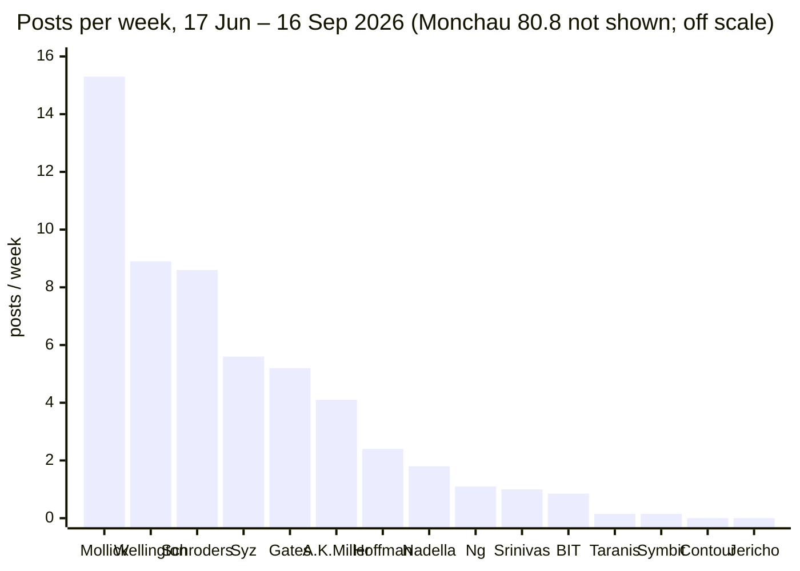
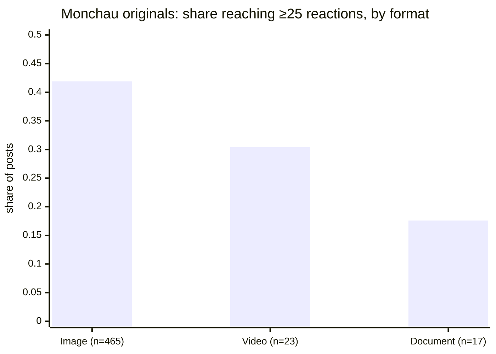
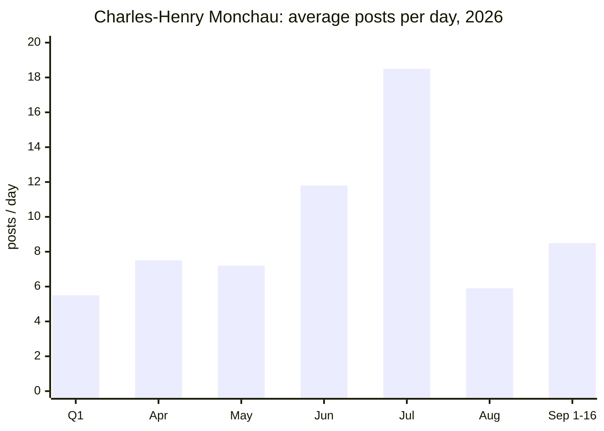

# Taranis Market Sentiment: competitive LinkedIn and product-positioning review

Prepared 26 Oct 2026 for Taranis SA. Raw data is in this folder: `posts_raw.csv` (76 posts), `count_queries.csv` (83 count queries), `data/` (the dashboard's tables), and the two research notes `step1_competitors_research.md` and `step2_product_pages_research.md`.

**How the numbers were made.** LinkedIn figures come from Crustdata's indexed post dataset (`/social_post/search`). Cadence is measured with free `limit=0` count queries. Engagement comes from small paid pulls of top posts. The main window is the **13 weeks from 17 Jun to 16 Sep 2026**.

## Data limits

- **The index stops around 17 Sep 2026.** Only 471 posts platform-wide are dated after 18 Sep, so the last ~40 days are missing.
- **No live refresh was possible.** TinyFish browser runs on the Taranis page and Monchau's profile both hit LinkedIn's login wall ([run 1](https://agent.tinyfish.ai/runs/9401bbfb-fcce-4af2-9841-3fefb83002df), [run 2](https://agent.tinyfish.ai/runs/abfe66ad-092a-49ea-ae36-76c4d11f9528)).
- **Older post dates in the index are imputed.** Many 2022–2024 posts share one timestamp. Every row in `posts_raw.csv` therefore carries a `true_date_utc` decoded from the LinkedIn activity ID (`id >> 22` = ms since epoch). For 2026 posts the index date matches within about a day.
- **The index's `post_type` label is not a curation signal.** It says `repost_without_thoughts` even on self-authored posts, such as Nadella's [earnings post](https://www.linkedin.com/posts/satyanadella_just-wrapped-our-earnings-call-it-was-a-activity-7488369807969370112-3kA1). It reflects how the crawler found a post. Curation below is measured from text instead (a "Source:" credit).
- **Follower counts.** Taranis shows **1,976 followers** in the index's actor headline ([Crustdata, company 7865447](https://www.linkedin.com/company/taranis-sa)). Monchau's "290,000+" comes only from a search snippet the TinyFish run found, so it is **unverified**. No other follower counts were collected.
- **Topic shares are keyword matches.** One post can match several topics, so they are lower bounds, not a full classification.
- **Budget.** About 36 of 89 Crustdata credits were spent, so posts were sampled (top-N by reactions) rather than pulled in full.

---

## 1. Executive summary

1. **No close competitor runs LinkedIn well, so the space is open.** Contour (Schroder GAIA), Jericho and Shannon River have **zero** company-page posts in the index. Their PMs post essentially nothing: Meyer and Resnick have 1 post combined, ever. BIT Capital is the only active competitor, at about 0.85 posts a week, and most of its posts promote its founder's podcasts ([counts](count_queries.csv)).
2. **Taranis posts about as rarely as its competitors.** The company page published 2 posts in 13 weeks and 15 ever, and Julien Leegenhoek published 1 in the window. Nearly every company post reshares Leegenhoek's BFM Business TV appearances ([example](https://www.linkedin.com/posts/taranis-sa_alphabet-spacex-ugcPost-7491428907817181185-FcZs)). Those posts get 14–52 reactions.
3. **Individuals carry the reach, not company pages.** Symbit's company page got **0 reactions** for its allocator-roadshow post, while co-founder Marius Skrondal's one-line reshare of the same news got **108** ([company](https://www.linkedin.com/posts/symbit-capital_we-just-wrapped-a-week-on-the-road-meeting-activity-7474743165929885696-pqfo) vs [founder](https://www.linkedin.com/posts/marius-skrondal_we-just-wrapped-a-week-on-the-road-meeting-activity-7474749100635176960-0GyQ)). Leegenhoek's own posts outperform the company page's reshares of them (64 vs 14).
4. **Monchau is a curation engine, not a pattern to copy one-for-one.** He averages about **81 posts a week** (1,051 in 13 weeks), and **86%** credit an outside "Source:". Curated posts clear 54 reactions 59% of the time. His own-view and Syz-branded posts clear it **5%** of the time (4 of 78). His biggest posts are humor, such as the [Pierce Brosnan photo](https://www.linkedin.com/posts/charles-henry-monchau-cfa-cmt-caia-4003096_the-camera-man-is-a-genius-for-those-activity-7505271378573594624-jGSn) with 17,611 reactions. At 1,976 followers, Taranis cannot win on curation volume.
5. **The TMS product page is the weakest in the set.** Behind its professional-investor gate it shows 3 paragraphs: no returns, factsheet, fund facts or team. It does not mention the ~50/50 systematic/discretionary split, and its only credential is a "Managed Futures" award, which contradicts the "Long/Short Technology" positioning ([teardown](step2_product_pages_research.md)). Schroders/Contour and UBP/Shannon River publish full performance behind the same kind of Swiss gate. BIT publishes it openly.
6. **Recommendation:** a founder-led channel. Leegenhoek posts 3 original-view posts a week, built around one recurring piece only TMS can make: a weekly chart of TMS's own sentiment/risk-appetite signal. The company page posts 2 a week (signal chart, monthly letter, BFM clips). That is about 5 posts a week in total, roughly 6× BIT and far above every other competitor. Fix the product page first, because LinkedIn traffic lands there.

---

## 2. Competitor set

Wellington Disruptive Technology & Innovation, Wavelength and Act II were dropped. Wellington's fund launched in 2020, its last data is USD 10.6m from Mar 2021, and it is no longer on wellington.com. Wavelength and Act II have no current footprint. BIT Capital, Symbit and Shannon River replaced them. Full screening is in [step1_competitors_research.md](step1_competitors_research.md).

| # | Fund (manager) | AUM (date) | HQ | Strategy | Vehicle | Why it is close to TMS | Source |
|---|---|---|---|---|---|---|---|
| 1 | **BIT Global Technology Opportunities** (BIT Capital) | Fund ~EUR 685–690m (aggregators, no as-of date); firm EUR 3.0bn (Oct 2026) | Berlin | Concentrated tech/AI infrastructure; ">75% of all trades influenced by systematic data signals"; can short via CFDs and swaps | Lux SICAV-FIS (AIF), professional investors only | **Same hybrid model**: a systematic AI/data layer plus a discretionary human decision. Caveat: retail-heavy brand, net-long | [bitcap.com fund page](https://bitcap.com/en/fonds/bit-global-technology-opportunities), [bitcap.com](https://bitcap.com/en), [finanzen.net](https://www.finanzen.net/fonds/bit-global-technology-opportunities-fis-i-lu1640611676) |
| 2 | **Schroder GAIA Contour Tech Equity** (Contour AM) | USD 860.9m (22 Oct 2026) | New York | TMT long/short; top-down plus bottom-up; discretionary; SOFR+ target | Lux UCITS; Swiss qualified-investor distribution | **Same shelf**: tech L/S UCITS sold to Swiss and EU professional investors | [finanzen.ch](https://www.finanzen.ch/fonds/schroder-gaia-contour-tech-equity-a1-lu1725199464), [contourasset.com](https://www.contourasset.com/index) |
| 3 | **Symbit Global Equity L/S** (Symbit Capital) | Not disclosed (launched Jul 2026) | Zug | "AI-native": discretionary research plus proprietary AI, which assesses "investor sentiment" among other inputs; market-neutral, ~200% gross | Irish ICAV (AIF), professional investors | **Swiss boutique with a hybrid AI L/S model**; generalist, no track record | [Hedgeweek](https://hedgeweek.com/news/new-york-investment-veterans-launch-ai-native-hedge-fund-in-switzerland), [symbit.com](https://www.symbit.com/welcome) |
| 4 | **U Access (IRL) Shannon River UCITS** (Shannon River / UBP) | USD 21.4m UCITS (22 Oct 2026; may be one share class); firm ~USD 905m | New York; UBP Geneva platform | Mid-cap tech L/S; ~half of longs are second-order AI beneficiaries; net 20–50% | Irish UCITS on UBP's U Access platform | **Sold through a Geneva private bank** to the same Swiss buyers; boutique-sized vehicle | [UBP fund page](https://www.ubp.com/en/asset-management/funds/ie00bkdrxc08), [The Hedge Fund Journal](https://thehedgefundjournal.com/u-access-shannon-river-ucits-mid-cap-tech-equities/) |
| 5 | **Jericho Capital** (Josh Resnick) | ~USD 10.1bn (third-party estimate from ADV) | LA / NY | Global TMT L/S, concentrated, discretionary | Private hedge fund LPs | The leading pure-TMT L/S franchise; **aspirational benchmark**, not like-for-like | [QuiverQuant](https://www.quiverquant.com/institutions/Jericho%20Capital%20Asset%20Management%20L.P./), [Institutional Investor](https://www.institutionalinvestor.com/article/premium/jerichos-three-year-hot-streak-shows-no-signs-cooling) |

**Not verified:** BIT fund-size date, whether Shannon River's USD 21.4m is the whole UCITS, Symbit AUM, Contour's LinkedIn page, and Jericho AUM (third-party estimate).

---

## 3. Product-page comparison

| Fund | Gate | Strategy text | Performance shown | Team | CTAs | Source |
|---|---|---|---|---|---|---|
| **TMS** | Country → professional/retail → "I Accept" | 3 paragraphs: "fundamental stock picking with a quantitative overlay on risk appetite and positioning"; no sleeve split | **None** (award line only) | None | Contact only | [taranis.net/investment/tms](https://taranis.net/investment/tms) |
| BIT GTO | None (marketing banner, "professional investors only" tag) | Medium, plus firm AI metrics (">30,000 alternative data signals analyzed daily") | Public NAV, charts, risk metrics, KID, factsheet subscription | Named PMs, team page | Invest now (19 brokers), factsheet, podcast | [bitcap.com](https://bitcap.com/en/fonds/bit-global-technology-opportunities) |
| Contour (Schroders) | Swiss qualified-investor "I agree" | Legal objective (Schroders); 4-paragraph thesis on contourasset.com | **Full**: annual returns (FY23 +41.9%, FY25 +32.5%), 5y +81.2%, monthly factsheet | PM (Schroders); ~15 bios (Contour site) | Watchlist; "Get in touch" | [contourasset.com](https://www.contourasset.com/index); Schroders CH fund centre |
| Symbit | None (no fund data) | Philosophy: "human experience and machine intelligence, working together" | None | 4 founders, with LinkedIn links | LinkedIn only | [symbit.com](https://www.symbit.com/welcome) |
| Shannon River (UBP) | Not-US → country/profile → legal | None (data-only page) | **Full**: NAV, MTD–ITD, KID, prospectus | None | Login, newsletter | [ubp.com](https://www.ubp.com/en/asset-management/funds/ie00bkdrxc08) |
| Jericho | None | None (holding page) | None | Founder bio | Email, phone | [jerichocap.com](https://www.jerichocap.com) |

**What this means for TMS.** The gate is in line with Schroders and UBP and is not the problem. What sits behind it is the problem:
- Add a post-gate factsheet download.
- State the two sleeves and their weights.
- Name the PMs.
- Replace or relabel the "Managed Futures Newcomer 2023" award.
- Copy BIT's habit of putting numbers on the systematic edge, for example signals per day or the share of risk decisions driven by the overlay.

No screenshots were saved; the browser-run IDs are listed in the research note.

---

## 4. LinkedIn cadence and format (13 weeks, 17 Jun – 16 Sep 2026)

| Account | Channel | Posts / 13w | Posts / week | Dominant format (top posts) | Best post (reactions) | Source |
|---|---|---|---|---|---|---|
| BIT Capital | Company page (+ founder podcasts) | 11 | 0.85 | Image with long German text plus a disclaimer | [NAV-milestone post](https://www.linkedin.com/posts/bit-capital-gmbh_bitcapital-technologyinvesting-ucits-activity-7470861891536355330-zCqW) (195) | Crustdata company 1120813 |
| Jan Beckers (BIT) | Individual | 2 | 0.15 | Image + policy view | [AI-policy post](https://www.linkedin.com/posts/janbeckers_der-cutoff-von-fable-zeigt-der-handlungsdruck-activity-7472221813419397120-quQx) (143) | Crustdata, profile URL |
| Symbit Capital | Company page | 2 | 0.15 | Article / image | 0 reactions on both | Crustdata company 74483772 |
| Symbit founders (4) | Individuals | 2 | 0.15 | Short quote-reshare | [Skrondal](https://www.linkedin.com/posts/marius-skrondal_we-just-wrapped-a-week-on-the-road-meeting-activity-7474749100635176960-0GyQ) (108) | Crustdata, 4 profile URLs |
| Contour Asset Mgmt | none | 0 | 0 | – | – | Crustdata company 6803658 |
| Schroders (Contour's fund platform) | Company page | 112 | 8.6 | Image; HR and corporate news; Contour/GAIA mentioned 2× ever | [Empower list post](https://www.linkedin.com/posts/schroders_empowerrolemodels-futureleaders-inclusion-activity-7490345910531432448-TkFu) (553) | Crustdata company 1051043 |
| Shannon River | Company page exists, 0 posts | 0 | 0 | – | – | Crustdata company 12895966 |
| Jericho Capital | none | 0 | 0 | – | – | Crustdata company 1348019 |
| **Taranis** | Company page reshares CEO TV clips | 2 | 0.15 | Video / article (BFM clips) | [Fundraising panel](https://www.linkedin.com/posts/taranis-sa_emergingmanagers-hedgefunds-alternativeinvestments-ugcPost-7429190604317753344-mL-E) (52, Feb 2026) | Crustdata company 7865447 |
| **Julien Leegenhoek** | Individual | 1 | 0.08 | Image + French TV recap | [AI-disruption post](https://www.linkedin.com/posts/julien-leegenhoek_ai-tech-investment-activity-7453425812810358784-PdDb) (64) | Crustdata person 237668409 |

The individuals' rows for Contour (Meyer) and Jericho (Resnick, Tan, Tang, O'Hanlon) show 0–2 posts **all-time**; Crustdata may have incomplete coverage of low-activity profiles.

**Format mix and engagement by format.** The only sample big enough to test this is Monchau's 507 index-labelled original posts (1 Jun – 16 Sep 2026). The chart below shows the share of each format's posts that reached at least 25 reactions ([counts](count_queries.csv)):

Single charts beat carousels for a markets audience. Image is 92% of his originals and has the best hit rate; documents (PDF carousels) have the worst. Every competitor's top post is also an image.

---

## 5. Monchau deep-dive (Crustdata person 28667460)

- **Cadence.** He went from 5.5 posts a day in Q1 to 11.8 in June and **18.5 in July**, then dropped to 5.9 in August (summer). Sep 1–16 is 8.5 a day, which matches the reference figure of 136 posts. The July spike may be partly index noise; it is not verified post by post.
- **Topic mix.** By keyword, 1 Jun – 16 Sep, n = 1,244: tech/AI 26%, macro/rates 15%, energy 12%, crypto 5%. These are below the earlier hand-classified Sept figures (29 / 28 / 21 / 4%) because keyword matching misses posts that are just a chart. Tech/AI is still his largest single topic.
- **Engagement distribution.** 56% of posts reach ≥54 reactions, 39% ≥100 and 22% ≥200, so the median in this wider window is about 65–70. The 16-day September window's median was ~54. Index-labelled originals alone have a median of ~18 (54% ≥15, 40% ≥25).
- **Curation vs own view.** 1,074 posts (86%) credit a "Source:", and 59% of them reach ≥54. Of the 170 posts without a source credit, 34% do. Explicit own-view or Syz posts ("my take", "our view", "Syz"; n = 78) reach it 5% of the time. His feed is an audience-built aggregator; his own investment views are not what travels.
- **Outliers are humor and fake "BREAKING" news:** [Pierce Brosnan, 17,611](https://www.linkedin.com/posts/charles-henry-monchau-cfa-cmt-caia-4003096_the-camera-man-is-a-genius-for-those-activity-7505271378573594624-jGSn), [fake Treasury appointment, 1,362](https://www.linkedin.com/posts/charles-henry-monchau-cfa-cmt-caia-4003096_breaking-effective-monday-14th-of-september-activity-7504471381355683841-Hxif). The best tech post is ["Hyperscaler debt is exploding"](https://www.linkedin.com/posts/charles-henry-monchau-cfa-cmt-caia-4003096_hyperscaler-debt-is-exploding-amazon-activity-7504939484937969664-4uAF) (230): one stat-dense chart with a 7-line narrative, which is the format TMS should borrow.
- **Refresh status.** A live refresh past 16 Sep was not possible (login wall; index lag). Re-run the count queries in `count_queries.csv` once the index catches up.

---

## 6. Famous tech voices

| Voice | Posts / week | Formats in top 3 | Best post (reactions) | What Taranis can borrow |
|---|---|---|---|---|
| Ethan Mollick | 15.3 | Image, text | [Book launch](https://www.linkedin.com/posts/emollick_i-have-a-new-book-coming-out-october-20-activity-7468411654381289472-oxlx) (3,928) | Daily first-hand tests with a clear verdict and dry humor: "we ran it, here's what we saw" |
| Bill Gates | 5.2 | Video, photo | [Buffett birthday](https://www.linkedin.com/posts/williamhgates_happy-birthday-warren-buffett-warren-ugcPost-7499851761705218048-XbDk) (42,692) | People and stories over data |
| Allie K. Miller | 4.1 | Video tutorial, numbered list | [Claude Code app tutorial](https://www.linkedin.com/posts/alliekmiller_if-your-barrier-to-building-an-app-was-code-ugcPost-7472370024033423360-MmLu) (2,362) | Numbered early-access takeaways; a recurring series ("AI homework") |
| Reid Hoffman | 2.4 | Podcast clips | [Nadella agents clip](https://www.linkedin.com/posts/reidhoffman_satya-nadella-described-a-future-at-microsoft-ugcPost-7475668981039955969-9UKc) (2,297) | Cut long-form media into 60–90s clips with one paragraph; the direct template for the BFM appearances |
| Satya Nadella | 1.8 | Text, photo | [Vera Rubin delivery](https://www.linkedin.com/posts/satyanadella_delivery-day-at-our-microsoft-dcs-as-the-ugcPost-7496695636868726785-Pjuo) (18,107) | Results-day post in his own words: 3–4 hard numbers, then the framework |
| Andrew Ng | 1.1 | Article, video | [AI-engineering skills map](https://www.linkedin.com/posts/andrewyng_new-a-map-of-the-most-important-skills-in-ugcPost-7494067762659512320-76O2) (14,177) | Low volume where every post is a useful artifact; one-line hook |
| Aravind Srinivas | 1.0 | Video demo, image | [CobbleDB](https://www.linkedin.com/posts/aravind-srinivas-16051987_we-built-a-replacement-for-aws-dynamodb-activity-7505723706539716608-4WuL) (2,935) | Builder proof: what we built and what it saves, in two sentences |

All counts are Crustdata, 17 Jun – 16 Sep 2026, by profile URL. Their engagement reflects follower bases in the millions, which were not collected, so compare their **formats**, not their numbers.

---

## 7. SWOT and recommendations

| | |
|---|---|
| **Strengths** | A real, ownable data asset (a market-sentiment/behavioral signal running since 2016, per the brief). A CEO with recurring national-TV airtime (BFM Business). Award history. A clear AI-disruption thesis ("we are in year 1 of AI disruption", [post](https://www.linkedin.com/posts/julien-leegenhoek_ai-tech-investment-activity-7453425812810358784-PdDb)). |
| **Weaknesses** | 1,976 followers. 0.15 posts a week. The company page only reshares TV clips. French-only recent posts limit reach outside francophone Switzerland. Product page shows no performance, sleeves or team. The award label conflicts with the strategy. |
| **Opportunities** | Competitors are nearly silent: Contour, Jericho and Shannon River have 0 posts, BIT 0.85 a week, Symbit 0.15 a week. Monchau shows a large Swiss/francophone audience for tech/AI market charts. No competitor publishes a proprietary sentiment read, so TMS can own the "what is the market's risk appetite this week" niche. |
| **Threats** | BIT is already telling the hybrid story with numbers and PR muscle. Symbit occupies "Swiss + AI + L/S". Swiss marketing rules (FinSA/CISA) constrain performance talk to the public. Copying Monchau-style curation would dilute the brand without his reach. |

**Recommended operating model**

1. **Channel: founder-led.** Julien Leegenhoek is the primary voice. A partner (e.g. Antoine Megarbane) posts about allocators and fundraising roughly every two weeks. The company page acts as the archive and re-shares with a one-line framing. Evidence: Symbit (0 vs 108) and Taranis (14 vs 64), founders outperform pages.
2. **Cadence: about 5 posts a week in total.**
   - Leegenhoek: 3 original posts a week.
   - Company page: 2 a week, made up of the weekly signal chart, one BFM clip or monthly letter, and fund news.
   - That is roughly 6× BIT's company page and 30× Taranis's current rate. It is sustainable without a content team; Monchau's 81 a week is not a target.
3. **Formats:**
   - **The signature recurring post.** Every Monday, one image chart of the TMS sentiment/risk-appetite gauge with three lines: what moved, what it historically implied, and what we're watching. It is original data no competitor has, it is the strongest format in the data (single image), and it explains the systematic sleeve without disclosing performance.
   - **BFM clips, Hoffman-style.** 60–90 seconds, subtitled, with one takeaway paragraph. Post in English plus French, not French only.
   - **Monthly "letter" carousel** for the discretionary AI-disruption sleeve: thesis updates in the style of BIT's case studies (Thesis / Edge / Signal). Limit carousels to monthly; they are the weakest format.
   - **Occasional builder-proof posts**, Srinivas-style, on the signal engine: how many sources it reads, how often it updates.
4. **Original view vs curation: about 80/20.** Curate only to frame a TMS view ("this chart, and what our signal says about it"). Monchau's data shows that pure curation wins on raw reactions only at his scale, and that firm-branded posts do worst. Taranis's lever is a distinct view, not volume.
5. **Compliance.** Follow BIT's pattern of a short risk line on every fund-related post. Keep performance figures off public LinkedIn and point to the gated factsheet. Have Compliance (Christian Wolf) pre-approve the weekly chart template once rather than each post.
6. **Fix the landing page before posting.** Add the post-gate factsheet, the two sleeves with their weights, named PMs, a corrected award label, and a "request factsheet / book a call" CTA.
7. **Measure monthly.** Re-run the free count queries in `count_queries.csv`, adding Leegenhoek's and the company page's reaction thresholds. Targets for 3 months: median ≥40 reactions on Leegenhoek's originals (current posts in the sample: 48–64), and 20+ posts a month in total.
