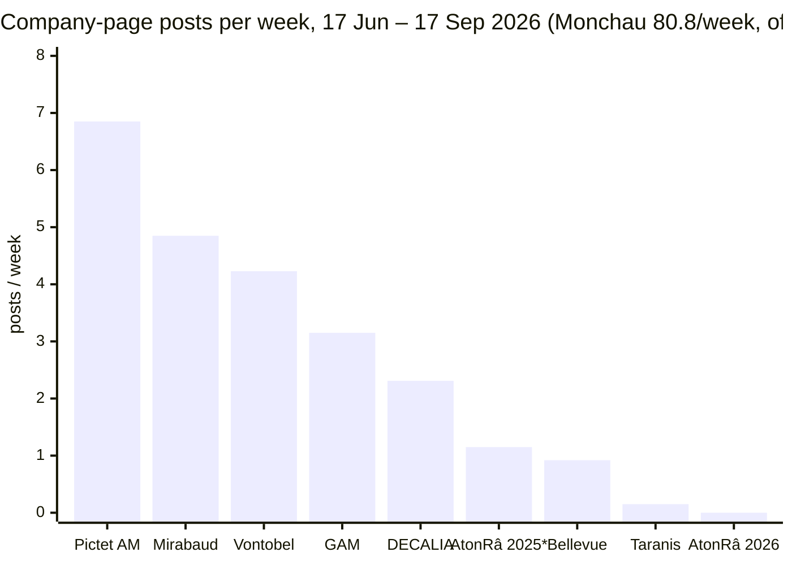

# Taranis Market Sentiment vs Swiss peers: product pages and LinkedIn

Prepared 27 Oct 2026 for Taranis SA. Companion to the earlier international review in [`../tms-linkedin-competitive-2026-10/REPORT.md`](../tms-linkedin-competitive-2026-10/REPORT.md).

**Files in this folder**
- `swiss_posts_raw.csv`: 23 posts.
- `count_queries_swiss.csv`: 54 count queries.
- `data/`: the dashboard's tables.
- `swiss_A_product_pages_research.md`: the full teardown with per-cell sources.
- Dashboard (updated, new Swiss section first): https://claude.ai/artifact/MVynfezk3JvMcLygRpKf54

**How the numbers were made**
- LinkedIn counts are Crustdata `/social_post/search` `limit=0` queries (free). The window is **17 Jun – 17 Sep 2026**, 13 weeks.
- Posts were sampled in small paid pulls (top-N by reactions), about 11 credits.
- Product pages were read with TinyFish and plain fetches on 27 Oct 2026.

## Data limits

- **The index ends around 17 Sep 2026.** LinkedIn's login wall blocks a live refresh (TinyFish confirmed this on 26 Oct).
- **AtonRâ's "0 posts in window" is an index gap, not silence.**
  - Crustdata entity 985778 is the right page (`/company/atonra`).
  - Its last indexed post is dated **30 Apr 2026**.
  - But web search found a live company post dated **30 Sep 2026** ([post](https://www.linkedin.com/posts/atonra_invest-with-proof-not-faith-activity-7511080011416875008-nFgh)) and staff posts on 8 and 16 Sep.
  - atonra.ch published **9 dated research notes between 2 Jul and 29 Sep 2026** ([research hub](https://www.atonra.ch/investment-research)).
  - The same 13 weeks in 2025 show **15** indexed AtonRâ posts (~1.2/week), which is the best estimate of its real cadence.
- **Index dates drift.** Decoding LinkedIn post IDs (`id >> 22` = ms since epoch) shows `date_posted` off by up to about 4 weeks even for 2026 posts. Example: an AtonRâ post dated 11 Mar is indexed as 7 Apr. Window counts are approximate at the edges. Every CSV row carries `true_date_utc`.
- **Late June looks under-indexed for everyone.** 17–30 Jun holds 0 DECALIA and 2 Pictet posts, against 10–37 per full month.
- **Pictet and DECALIA counts include corporate content.** Results, hires, interns and events make up much of each feed; see topics below.
- **Topic shares are keyword matches** (lower bounds; groups overlap).
- **`post_type` is the index's label, not a curation signal.** Curation is measured by a "Source" credit in the text.
- **Founding year.** The brief says Taranis was founded in 2021, but Crustdata lists 2020. Leegenhoek's Sep 2024 post says "since founding Taranis four years ago" ([post](https://www.linkedin.com/posts/julien-leegenhoek_withintellligence-liquidalternatives-alphagenerator-activity-7239259080861626368-FwAo)). Not resolved.
- **DECALIA's fund pages stayed gated.** The browser run could not pass its investor-category gate, so DECALIA's product facts come from its public factsheet and FT.

---

## 1. Executive summary

- **TMS discloses the least of any Swiss peer.**
  - AtonRâ (no gate), DECALIA (public factsheet) and Pictet (fund pages behind an audience selector) all publish full performance, fund facts and documents.
  - The TMS page, behind its professional-investor gate, shows **three paragraphs, no ISIN, fees, AUM, returns, documents or team**. Its only credential is a 2023 "Managed Futures" award ([TMS](https://taranis.net/investment/tms); comparison in §2).
- **TMS has the most distinctive strategy in the set.** It is the only **tech long/short with a behavioural-sentiment quant overlay**.
  - AtonRâ sells long-only thematic certificates.
  - DECALIA Future SOCIETY is long-only multi-thematic.
  - Pictet Robotics/Digital are long-only. Pictet's L/S, TR-Atlas Titan, is generalist ([Atlas Titan](https://am.pictet.com/ch/en/institutions/funds/pictet-tr-atlas-titan/LU2206555984)).
- **Taranis posts the least on LinkedIn: 0.15 posts/week.**
  - DECALIA 2.3/week, Pictet 6.8/week (corporate-heavy), AtonRâ about 1.2/week (estimated; see Data limits).
  - Among wider Swiss peers: Vontobel 4.2, Mirabaud 4.8, GAM 3.2, Bellevue 0.9 ([counts](count_queries_swiss.csv)).
- **People carry engagement in Swiss finance too.**
  - DECALIA CIO Fabrizio Quirighetti's light post got **153** reactions ([post](https://www.linkedin.com/posts/fabrizio-quirighetti_playmobil-g7-suisse-activity-7472977106063486976-Dvvg)), against the company page's best of **63**.
  - At Taranis, the CEO's own posts get 48–64 reactions; the page's reshares of them get 14.
  - Pictet's thematic PMs posted **0** times in the window.
- **The tech/AI thesis lane is open.**
  - AtonRâ writes the strongest original tech theses (China tech, grid, AI capex) but gets **0–10 reactions** per post.
  - DECALIA's feed is only 13% tech/AI.
  - No Swiss peer runs a personal tech-AI voice with reach.

---

## 2. Deliverable A: product-page teardown

| Attribute | AtonRâ: [AI & Robotics AMC](https://www.atonra.ch/investment-funds/ai-robotics) | DECALIA: [Future SOCIETY](https://funds-static.pictet.com/funds/decalia/factsheet/MR_ES_en_LU2407358063_YES_2026-05-31.pdf) | Pictet AM: [Robotics](https://am.pictet.com/ch/en/intermediaries/funds/pictet-robotics/LU1279334210) (+ Digital, TR-Atlas Titan) | Taranis: [TMS](https://taranis.net/investment/tms) |
|---|---|---|---|---|
| **Structure** | Product page in a 12-theme site: description, monthly performance grid, statistics, holdings, risks; sidebar with price, ISIN, factsheet, KIID | Strategy themes on the corporate site; fund pages on a separate gated SICAV site ([funds](https://www.decalia.com/en-ch/funds/)) | Standard microsite per share class: key info, objective, process, performance, risk, portfolio, literature | One heading, 3 paragraphs, award line, disclaimer |
| **Navigation / languages** | 2–3 clicks, no gate; English only seen (not verified) | 3+ clicks plus gate; EN/FR/DE/IT ([fr-ch](https://www.decalia.com/fr-ch/)) | 3+ clicks, audience in the URL; EN/FR/DE/IT | 2 clicks plus gate; English only |
| **Vehicle / domicile** | JP Morgan-issued AMC XS1668112011; UCITS umbrella LU2170994805 ([fund](https://www.atonra.ch/investment-funds/the-atonra-fund)) | Lux UCITS SICAV (ManCo FundPartner Solutions) | Lux UCITS SICAV; Robotics Art. 8 | Not shown |
| **Inception** | Jun 2019 | Nov 2021 | Oct 2015 (Robotics P EUR) | Not shown |
| **Fees** | 1.30% management + 0.20% issuer + 15% performance fee ([factsheet](https://atonra.stainly-bench.com/report/factsheet-artificial-intelligence-robotics-xs1668112011/)) | OCF 1.60% ([FT](https://markets.ft.com/data/funds/tearsheet/summary?s=LU2407358063:EUR)) | Not on page; OCF 1.98% ([FT](https://markets.ft.com/data/funds/tearsheet/summary?s=lu1279334210:eur)) | Not shown |
| **AUM / benchmark** | Not shown / MSCI ACWI (reference) | EUR 139m (31 May 2026) / MSCI World NR EUR | EUR 13.0bn (26 Oct 2026) / MSCI AC World | Not shown / none |
| **Performance** | **Full**: YTD on the page; monthly net returns 2019–2026 in the factsheet | **Full** in the public factsheet (YTD, 1Y, 3Y, since inception, calendar years) | **Full** on the page vs benchmark | **None** |
| **Documents** | Factsheet, KIID | Factsheet public; KID and prospectus behind the gate | Factsheet, KID, prospectus, annual and semi-annual reports, SFDR, NAV history | None |
| **Risk disclosure** | SRI 6 in the factsheet; the page itself says "no specific risks information available" | SRI scale plus risk text | Full SRI, extra risks, capital-loss warning | Gate disclaimer only |
| **Minimum / share classes** | Not shown / one certificate | No minimum (R) / R, RP, IP, A1P, S | Not on page / many classes, each with its own URL | Not shown |
| **Strategy, own words** | AI pure players across "semiconductors, data, software applications, robotics" | "multi-thematic global equity fund, investing in innovative sectors and disruptive companies" | "Active, high conviction, stock picking approach" | Fundamental picks "with a quantitative overlay on risk appetite and positioning" |
| **Hook** | "The third step of technological evolution" | "disruptive companies shaping our society" | "Robots are no longer confined to the factory floor" | "Anticipate Trends" (site title) |
| **Differentiators** | Research heritage since 2004; 1,300-sub-sector taxonomy; AI/quant platform Fundy | Multi-thematic, active ESG, mid-cap bias, barbell; top-decile 2026 ([finews](https://www.finews.com/news/english-news/74003-decalia-future-society-fund-interview-quirien-lemey-iana-perova)) | Scale, a 30-year thematic franchise, ESG | Behavioural-sentiment algorithm; long/short |
| **Systematic vs discretionary** | Hybrid: discretionary themes, systematic optimisation | Discretionary | Discretionary; Atlas Titan adds quant indicators | Hybrid |
| **Audience / tone** | Broad ("seasoned investors to newcomers"); marketing-heavy | Private + institutional; factual | Segmented individuals / intermediaries / institutions; regulatory and technical | Qualified/professional investors in CH/UK; short and low in information |
| **Gate** | None | Investor category + country | Profile selector in the URL | Country → professional/retail → "I Accept" |
| **Primary CTAs** | Factsheet, KIID, contact, WhatsApp, login | "Discover the DECALIA funds", newsletter | Download factsheet / NAV / all literature | Contact only |

**Positioning summaries**

- **AtonRâ** ([AI & Robotics](https://www.atonra.ch/investment-funds/ai-robotics)) sells thematic tech as 12+ single-theme certificates plus a UCITS umbrella. Its proof is research depth: equity research since 2004, a 1,300-sub-sector taxonomy, and the AI/quant platform Fundy, which on 29 Sep launched a systematic World Multi-Factor certificate with ZKB ([note](https://www.atonra.ch/research/same-drawdown-more-upside-atonra-world-multi-factor-goes-live)). Pages are open, show price, YTD and ISIN, and link to a factsheet with monthly returns. It is the closest Swiss match to TMS on **tech theme and hybrid method**, but it is long-only and retail-friendly in tone.
- **DECALIA** ([Future SOCIETY factsheet](https://funds-static.pictet.com/funds/decalia/factsheet/MR_ES_en_LU2407358063_YES_2026-05-31.pdf)) runs a EUR 139m long-only multi-thematic growth fund that is now ~52% IT and ~35% AI infrastructure, with a mid-cap/healthcare barbell. It markets through PM interviews (Quirien Lemey, Iana Perova) and multilingual corporate pages. The fund site is gated, but full-performance factsheets are public on Pictet's document server. Tech exposure is real but not the brand: the fund themes in DECALIA's own Crustdata profile are European banking, yield, long-term trends and European inefficiencies ([LinkedIn](https://www.linkedin.com/company/decalia-asset-management-sa)).
- **Pictet AM** ([Robotics](https://am.pictet.com/ch/en/intermediaries/funds/pictet-robotics/LU1279334210)) is the scale benchmark. Robotics alone is EUR 13bn and Digital USD 4.3bn, each with a standardised page carrying NAV, size, SRI, benchmark-relative returns and a full document library. Its tone is regulatory, not personal. TR-Atlas Titan (EUR 688m), a discretionary global L/S, is Pictet's closest analogue to TMS, but it is not tech-specific.
- **Taranis** ([TMS](https://taranis.net/investment/tms)) has the most differentiated strategy in the set and the thinnest page. The public intro ([/investment](https://taranis.net/investment)) now says TMS "uses alternative data and a systematic overlay". That reads more quant than the gated page's "fundamental stock picking with a quantitative overlay", so the two should be aligned.

**Wider Swiss scan** ([details](swiss_A_product_pages_research.md#iii-swiss-peer-scan))
- **Vontobel** has no dedicated tech fund; the nearest is the multi-theme Megatrends fund.
- **GAM** runs Star Disruptive Growth, a long-only fund.
- **Bellevue** is healthcare only (Digital Health, AI Health).
- **Mirabaud** has no tech fund.

So in Switzerland, AtonRâ and Pictet are the only firms with dedicated tech/AI products.

---

## 3. Deliverable B: LinkedIn activity (17 Jun – 17 Sep 2026)

| Competitor | Channel | Posts / week | Dominant format | Original vs curated | Median reactions | Best post |
|---|---|---|---|---|---|---|
| **DECALIA** | Company page + CIO Quirighetti (key people 8 posts, 0.6/week) | **2.31** (Jul 10, Aug 14, Sep 1–17 6) | Mixed: document 9, image 7, article 7, video 6 of 30 | 73% original; **0** "Source" credits | ~14 (93% ≥10, 43% ≥15) | [Team cycling, 63](https://www.linkedin.com/posts/decalia-asset-management-sa_decalia-teamspirit-cycling-activity-7493591569711755264-pQqi) |
| **Pictet AM** | Company page only; thematic PMs posted 0 | **6.85** (Jul 36, Aug 37, Sep 1–17 14) | Image 47, video 24, document 11, article 5 of 89 | 76% original; 1 "Source" credit | ~25 (51% ≥25, 21% ≥50) | [H1 2026 results, 147](https://www.linkedin.com/posts/pictet-asset-management_today-the-pictet-group-announced-the-figures-activity-7499022732894855168-PQMN); AI-enhanced ETF launch, [141](https://www.linkedin.com/posts/pictet-asset-management_we-are-launching-our-first-european-range-activity-7477986927124860928-vZy_) |
| **AtonRâ** | Company page + staff (BD lead Victor Marchand) | **0 indexed** (est. ~1.2 from 2025's same window; live posts exist) | Image + long-form thesis | 13 of 15 2026 posts original; data-dense, own-research links | ~6 (4 of 15 ≥10 in 2026) | [China tech / Middle East thesis, 10](https://www.linkedin.com/posts/atonra_thematicinvesting-atonra-chinatech-activity-7444624629765214209-6YMx) |
| **Taranis** | Company page reshares CEO TV clips | **0.15** | Video / article | Reshares of the CEO's own posts | ~14 | [Fundraising panel, 52](https://www.linkedin.com/posts/taranis-sa_emergingmanagers-hedgefunds-alternativeinvestments-ugcPost-7429190604317753344-mL-E) |
| *Monchau (benchmark)* | *Individual* | *80.8* | *Image* | *86% "Source"-credited* | *~65–70* | see the earlier report |

\*AtonRâ 2025 is the same 13 weeks one year earlier, shown as its estimated real cadence; 2026 reads 0 because of the index gap.

**Topics** (keyword counts; [queries](count_queries_swiss.csv))

| Topic | DECALIA (n=30) | Pictet AM (n=89) |
|---|---|---|
| Markets / outlook | 47% | 29% |
| Tech / AI | 13% | 26% |
| Fund / strategy | 13% | 13% |
| Corporate / HR / events (keyword) | 10% | 9% |

The corporate share is understated by keywords: DECALIA's 5 top posts are a team ride, a client conference and two EAM-panel posts, and Pictet's top 5 include H1 results and two Spanish award or education posts.

**What Taranis can learn: where the gap is**

- **DECALIA.**
  - It sets the Swiss boutique bar: about 2 posts a week, multilingual (FR/EN), and mostly events, people and conference recaps.
  - The CIO is the real reach engine. Quirighetti's humour and AI-economics posts (["Are you token to me?"](https://www.linkedin.com/posts/fabrizio-quirighetti_bloomberg-ai-mag7-activity-7480640956753547264-v_r0), 43, with a source credit and his own read-through) beat the page.
  - *Gap:* DECALIA barely talks tech, so Taranis can own tech while matching DECALIA's rhythm.
- **Pictet AM.**
  - Cadence, production quality (24 videos in 13 weeks) and a risk warning on product posts.
  - Its strongest product post was an **AI**-model launch.
  - *Gap:* no personal voices. Robotics and Digital PMs posted nothing, so Pictet cannot compete on a named, opinionated tech PM.
- **AtonRâ.**
  - It proves the format Taranis wants: original, data-dense tech theses linking to its own research.
  - It also proves the format alone does not travel: 0–10 reactions, posted under a brand page, with YTD performance claims inside posts ([example](https://www.linkedin.com/posts/atonra_thematicinvesting-atonra-chinatech-activity-7455499972474753025-B7ws): "up 10.3% YTD and 60% since launch").
  - *Gap:* the same theses posted by a named founder with TV visibility, kept compliant with no performance in posts.

---

## 4. SWOT: Taranis's own LinkedIn

| | |
|---|---|
| **Strengths** | A distinctive product story (sentiment engine since 2016, plus an AI-disruption sleeve since Dec 2025). A CEO with BFM Business airtime and a Lombard Odier Technology Fund PM background (per brief). His own posts already outperform the page (64 vs 14). |
| **Weaknesses** | 0.15 posts/week, the lowest in the Swiss set. The company page is a mirror of TV clips. Recent posts are French-only. The landing page discloses nothing. 1,976 followers ([Crustdata](https://www.linkedin.com/company/taranis-sa)). |
| **Opportunities** | No Swiss peer has a tech-AI personal voice with reach: Pictet's PMs are silent, AtonRâ's theses get ~6 reactions, and DECALIA is 13% tech. DECALIA's 2.3/week is an attainable bar. Swiss audiences reward people and local colour (Quirighetti, 153). |
| **Threats** | AtonRâ is building a systematic/AI story too (Fundy, World Multi-Factor certificate, 29 Sep). Pictet now markets "AI-enhanced" equity with big budgets. FinSA advertising rules limit public performance talk; AtonRâ's in-post YTD claims are a pattern to avoid. |

## 5. Recommendations

1. **Benchmark cadence against DECALIA (Swiss-specific).** Lift the company page from 0.15 to **at least 2.3 posts a week**: a weekly TMS sentiment-gauge chart plus one fund, event or BFM-clip post. DECALIA's 30 posts in 13 weeks is the Swiss boutique bar.
2. **Take the tech-AI thesis lane AtonRâ has vacated (Swiss-specific).** Julien posts **one original AI-disruption thesis a week** under his own name: chart first, three lines of read-through, then a link to a short note. AtonRâ owns the format but not the audience (0–10 reactions, no indexed company posts since April). Pictet's tech PMs are absent.
3. **Lead with people, Swiss-style.** The founder and partners post in their own names in **FR and EN**. A light, local post now and then is allowed and works (Quirighetti, 153). The company page re-shares with a one-line frame.
4. **Fix the product page before pushing traffic.**
   - Add the vehicle, ISIN, fees and liquidity.
   - Show the systematic/discretionary split and named PMs.
   - Put a factsheet behind the existing gate, with a "request factsheet / book a call" CTA.
   - Relabel the "Managed Futures" award.
   - Align the /investment intro with the gated text.

   Every Swiss peer discloses performance somewhere.
5. **Stay compliant by design.** Put a one-line risk warning on fund posts (as Pictet does) and keep performance numbers behind the gate (unlike AtonRâ). Get Compliance to pre-approve the weekly chart template once.

**Measure:** re-run the free count queries in `count_queries_swiss.csv` monthly once the index catches up. Targets for 3 months:
- Company page ≥ 2.3 posts/week.
- Julien ≥ 1 original post/week.
- Median ≥ 25 reactions on Julien's originals (Pictet's company-page median).
